<h1 align="center">Hola, soy Agustín 👋</h1>

  

  📍 Santiago, Chile

  
  

---

### 🧑‍💻 Sobre mí

Estudiante de **Ingeniería en Informática** en la **Universidad Tecnológica Metropolitana (UTEM)**, en año de título.

- 🔭 Actualmente trabajando en **OriginsCL**, mi proyecto de título: un marketplace de streetwear para Chile
- 🌱 Foco en desarrollo web y backend, testing de APIs/endpoints y deployments en la nube

---

### 🛠️ Tech stack

  

- **Lenguajes:** Python · C · C++ · JavaScript · SQL · Dart
- **Backend:** FastAPI · APIs REST · Testing de endpoints con Swagger
- **Frontend / Mobile:** HTML · Flutter
- **Bases de datos:** PostgreSQL
- **Datos y ML:** scikit-learn · regresión lineal · redes neuronales
- **Herramientas:** Git · GitHub · Excel

---

### 🚀 Proyectos destacados

| Proyecto | Descripción | Stack |
|---|---|---|
| **OriginsCL** | Marketplace de streetwear para Chile (proyecto de título). Transacciones con máquina de estados, comisiones, calificaciones y verificación de identidad (KYC). | Flutter · FastAPI · PostgreSQL |
| **DIRECTA** (2026) | Plataforma de inteligencia operacional para directores de empresas, con arquitectura escalable y seguridad multi-tenant. A cargo de la app móvil y la documentación técnica. Equipo de 3. | Python · DeepSeek · PostgreSQL |
| **[Modelo predictivo de consumo de agua](https://github.com/agustin95q/ConsumoDeAgua)** (2025) | Modelos predictivos del consumo de agua en Santiago con regresión lineal y redes neuronales, para apoyar decisiones basadas en datos. Equipo de 3. | Python · scikit-learn |

---

### 🌎 Idiomas

Español (nativo) · Inglés (B1) · Portugués (B1)

---

### 📊 Estadísticas

  
  

  

---

  <picture>
    <source media="(prefers-color-scheme: dark)" srcset="https://raw.githubusercontent.com/agustin95q/agustin95q/output/pacman-contribution-graph-dark.svg">
    
  </picture>

